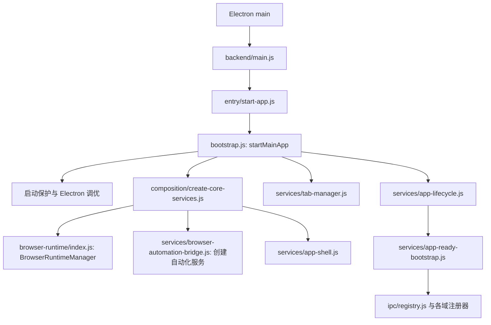
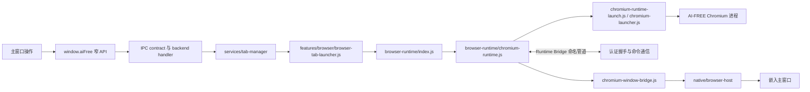

# 项目路径图

这页概括接手时最常追踪的三条路径。路径名采用代码中的模块名；`backend/services/` 是尚未完全按业务域收敛的过渡目录，详见[目录与进程边界](directory-map.md)。

## 主进程启动

`bootstrap.js` 是主进程 composition root：先建立核心服务，再装配应用外壳和标签管理，最后注册生命周期。`create-core-services.js` 除创建服务外也启动若干后台工作；追踪服务时应同时确认它的 ready/quit 生命周期。

## 浏览器启动

业务入口负责准入、环境配置和启动恢复；Browser Runtime 负责进程、协议和窗口生命周期。正式运行使用随项目提供的 AI-FREE Chromium，不回退到系统浏览器。详细启动事务和资源所有权见[Chromium 运行层接手说明](browser-runtime.md)。

## AI 自动化调用

```mermaid
flowchart LR
  Sidebar[AI 控制侧栏] --> Preload[preload 暴露的 AI API]
  Preload --> Contract[contracts IPC 通道]
  Contract --> Handler[features/ai-chat/register-chat-ipc.js]
  Handler --> Chat[features/ai-chat/ai-chat-service.js]
  Chat --> Tools[AI 对话工具集]
  Tools --> Bridge[BrowserAutomationBridge facade/runtime]
  External[外部 MCP 客户端] --> Gateway[BrowserAutomationExternalGateway<br/>127.0.0.1]
  Bridge --> Gateway
  Bridge --> Dispatch[NativeBrowserAutomation.dispatch]
  Gateway --> Dispatch
  Dispatch --> Manager[browser-runtime/index.js]
  Manager --> Pipe[Runtime Bridge 命名管道]
  Pipe --> Chromium[受管 AI-FREE Chromium 页面]
  Chromium --> Result[观察结果或动作结果]
  Result --> Dispatch
  Dispatch --> Tools
  Tools --> Chat
  Chat --> Sidebar
```

侧栏对话和外部 MCP 是两种入口；它们在主进程复用自动化执行能力。`BrowserAutomationBridge` 是应用服务/网关组合，`Runtime Bridge` 是它与受管 Chromium 通信所依赖的协议，两者不是同一个桥。

## 术语速查

- **浏览器环境 / Profile**：独立设置、数据目录和 Chromium 进程；业务 ID 为 `profileId`。
- **应用标签 / App Tab**：主窗口顶部的环境入口，当前与 `profileId` 对应。
- **网页标签**：Chromium 页面内标签，以协议索引 `tab_id` / `index` 表示；索引可能在关闭后变化。
- **Browser Runtime**：Chromium 进程、Profile、通信和窗口嵌入的主进程运行层。
- **Runtime Bridge**：Chromium 与主进程之间的认证命名管道通信协议。
- **Browser Automation Bridge**：主进程自动化工具、卡片执行和外部 MCP 网关服务。
